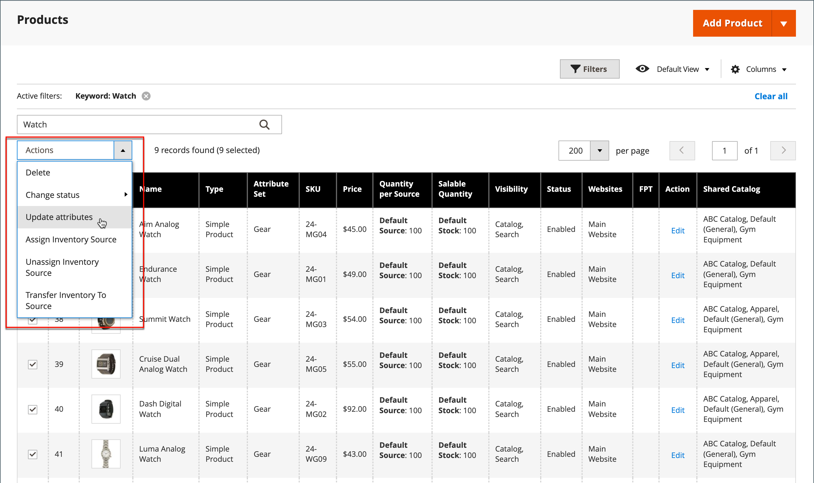
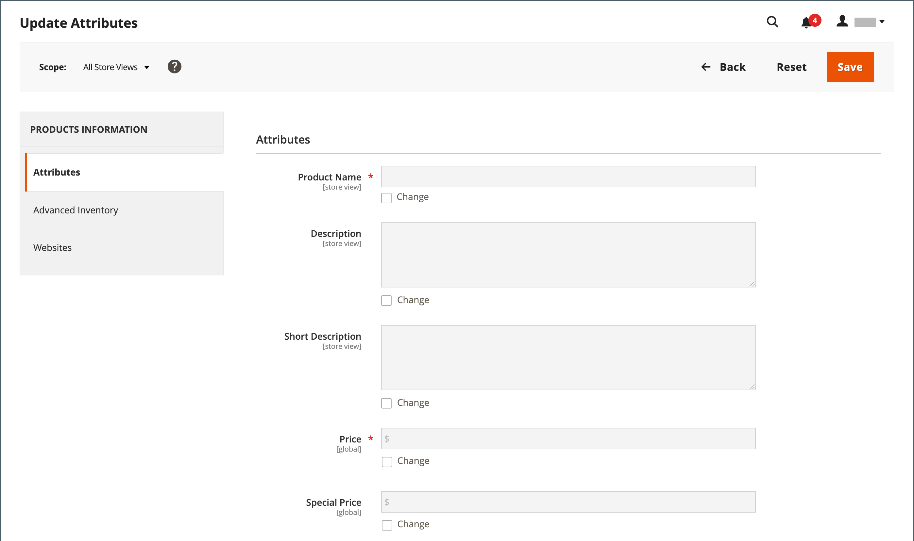

# Actualizaciones masivas de atributos de producto

Use la herramienta _[!UICONTROL Update Attributes]_&#x200B;para cambiar uno o varios atributos de sus productos. Esta herramienta le permite aplicar cambios significativos en un grupo grande de productos.

1. En la barra lateral _Admin_, vaya a **[!UICONTROL Catalog]** > **[!UICONTROL Products]**.

1. Seleccione los productos para los que desea modificar las fuentes.

   Busque los productos y marque las casillas de verificación correspondientes.

1. Haga clic en el menú **[!UICONTROL Actions]** en la parte superior y elija **[!UICONTROL Update Attributes]**.

   {width="600" zoomable="yes"}

1. Actualice el atributo, el inventario avanzado o los datos del sitio web para los productos seleccionados, según sus necesidades.

   {width="600" zoomable="yes"}

1. Cuando termine, haga clic en **[!UICONTROL Save]**.

