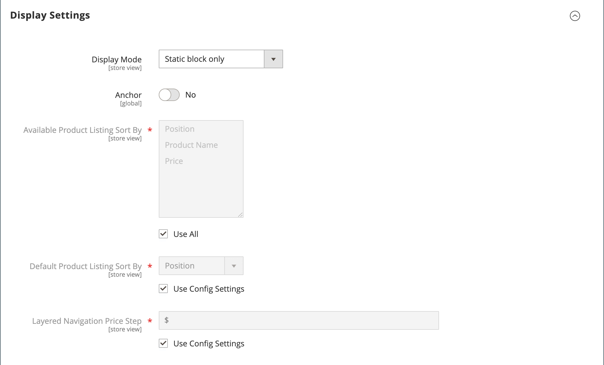

# Categorías: configuración de visualización

La configuración de visualización determina qué elementos de contenido aparecen en una página de categoría y el orden en que aparecen los productos. Puede habilitar bloques de CMS, establecer el estado de anclaje de la categoría y administrar las opciones de ordenación desde la pestaña _[!UICONTROL Display Settings]_. Para ver ejemplos de cómo se reflejan las categorías en la tienda, consulte [Navegación por el catálogo](navigation.md).

{width="600" zoomable="yes"}

| Campo | Descripción |
|--- |--- |
| [!UICONTROL Display Mode] | Determina los elementos de contenido mostrados en la página de categoría. Opciones: `Products Only` / `Static Block Only` / `Static Block and Products` |
| [!UICONTROL Anchor] | Cuando se establece en `Yes`, muestra los productos de las subcategorías de la categoría aunque no se hayan agregado explícitamente a ella y habilita la visualización de la sección _[!UICONTROL filter by attribute]_&#x200B;en la navegación por capas. Opciones: `Yes` / `No` |
| [!UICONTROL Available Product Listing Sort By] | (Obligatorio) Los valores predeterminados son `Position`, `Name` y `Price`. Para personalizar la opción de ordenación, anule la selección de la casilla de verificación **[!UICONTROL Use All Available Attributes]** y seleccione los atributos que desee utilizar. Puede definir y agregar atributos según sea necesario. Esta configuración no se aplica al [!DNL Live Search] [widget de página de lista de productos](https://experienceleague.adobe.com/en/docs/commerce/live-search/live-search-storefront/plp-styling). |
| [!UICONTROL Default Product Listing Sort By] | (Obligatorio) Para definir la opción predeterminada _[!UICONTROL Sort By]_, anule la selección de la casilla de verificación **[!UICONTROL Use Config Settings]**&#x200B;y seleccione un atributo. Esta configuración no se aplica al [!DNL Live Search] [widget de página de lista de productos](https://experienceleague.adobe.com/en/docs/commerce/live-search/live-search-storefront/plp-styling). |
| [!UICONTROL Layered Navigation Price Step] | De forma predeterminada, Commerce muestra el rango de precios en incrementos de 10, 100 y 1000, según los productos de la lista. Para cambiar el rango del paso Precio, anule la selección de la casilla **[!UICONTROL Use Config Settings]**. |

{style="table-layout:auto"}
