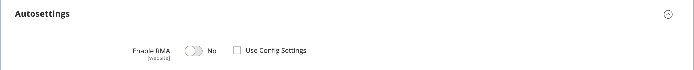

# Configuración del producto - [!UICONTROL Autosettings]

{{ee-feature}}

La sección _[!UICONTROL Autosettings]_incluye cualquier atributo que sea una dependencia para otras operaciones. Puede aplicar la configuración predeterminada [RMA configuration](../stores-purchase/rma-configure.md) al producto o anularla según sea necesario.

{width="600" zoomable="yes"}
