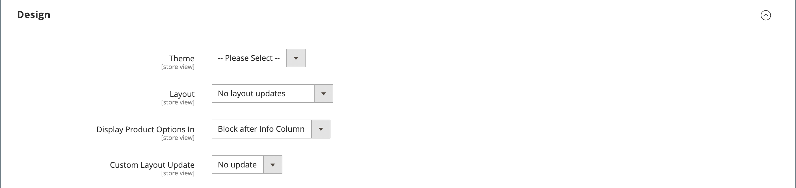

# Configuración del producto - [!UICONTROL Design]

La configuración de _[!UICONTROL Design]_&#x200B;permite aplicar un tema diferente a la página del producto, cambiar el diseño de la columna, determinar dónde aparecen las opciones del producto e introducir código XML personalizado.

{width="600" zoomable="yes"}

>[!NOTE]
>
>Cuando se asigna el mismo producto a varias categorías con diferentes configuraciones de diseño para cada categoría, se recomienda establecer **[!UICONTROL Use Categories Path for Product URLs]** = `Yes` en las [opciones de configuración de optimización del motor de búsqueda](../configuration-reference/catalog/catalog.md#search-engine-optimization). Para obtener acceso a esta configuración, vaya a **[!UICONTROL Stores]** > _[!UICONTROL Settings]_>**[!UICONTROL Configuration]**, expanda **[!UICONTROL Catalog]**&#x200B;y elija **[!UICONTROL Catalog]**&#x200B;debajo en el panel izquierdo y, a continuación, expanda la sección **[!UICONTROL Search Engine Optimization]**&#x200B;en la página.

| Campo | [Ámbito](../getting-started/websites-stores-views.md#scope-settings) | Descripción |
|---|---|----|
| [!UICONTROL Theme] | Vista de tienda |  (solo Adobe Commerce) Permite aplicar un tema diferente al producto. Opciones: (todas las temáticas disponibles) |
| [!UICONTROL Layout] | Vista de tienda | Permite aplicar un [diseño](../content-design/page-layout.md) diferente a la página del producto. Opciones:  **[!UICONTROL No layout updates]**: de forma predeterminada, las actualizaciones de diseño no están disponibles para la página del producto. **[!UICONTROL Empty]**: permite definir su propio diseño, como una página de 4 columnas. (Requiere conocimientos de XML.)  **[!UICONTROL 1 column]**: aplica un diseño de una columna a la página del producto. **[!UICONTROL 2 columns with left bar]**: aplica un diseño de dos columnas con una barra lateral izquierda a la página del producto.  **[!UICONTROL 2 columns with right bar]**: aplica un diseño de dos columnas con una barra lateral derecha a la página del producto. **[!UICONTROL 3 columns]**: aplica un diseño de tres columnas a la página del producto.  **[!UICONTROL Page -- Full Width]**- (Requiere [[!DNL Page Builder]](../page-builder/introduction.md)) Aplica el diseño de ancho completo para las páginas de CMS a la página de producto. **[!UICONTROL Category -- Full Width]** - (Requiere [!DNL Page Builder]) Aplica el diseño de ancho completo para las páginas de categoría a la página de producto.  **[!UICONTROL Product -- Full Width]**- (Requiere [!UICONTROL Page Builder]) Aplica el diseño de ancho completo para páginas de producto a la página de producto. |
| [!UICONTROL Display Product Options In] | Vista de tienda | Determina dónde aparecen las opciones del producto en la página del producto. Opciones: `Product Info Column` / `Block after Info Column` |
| [!UICONTROL Custom Layout Update] | Vista de tienda | Se utiliza para acceder a las opciones para actualizar un diseño personalizado en la página del producto. |

{style="table-layout:auto"}

