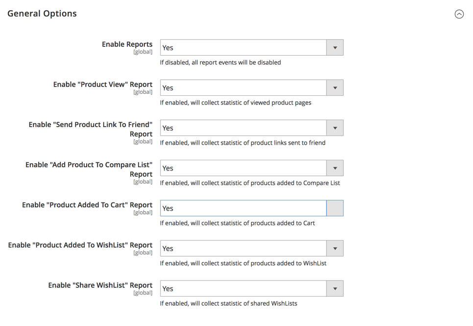

# [!UICONTROL General] > [!UICONTROL Reports]

{{config}}

## [!UICONTROL Dashboard]

<!-- zoom -->

<!-- [Dashboard](https://experienceleague.adobe.com/es/docs/commerce-admin/start/admin/tools/admin-dashboard) -->

| Campo | [Ámbito](../../getting-started/websites-stores-views.md#scope-settings) | Descripción |
|--- |--- |--- |
| [!UICONTROL Year-to-Date Starts] | Global | Especifica el mes y el día en que se basan los cálculos anuales hasta la fecha. |
| [!UICONTROL Current Month Starts] | Global | Especifica el día del mes que se utiliza en los cálculos para marcar el comienzo del mes actual. |

{style="table-layout:auto"}

## [!UICONTROL General Options]

<!-- zoom -->

>[!NOTE]
>
>Si las funciones de su empresa no requieren informes, le recomendamos que deshabilite la funcionalidad de informes para mejorar el rendimiento de la tienda. Sin embargo, algunas funciones, como los segmentos dinámicos de clientes, dependen de los datos de los informes para funcionar correctamente.

| Campo | [Ámbito](../../getting-started/websites-stores-views.md#scope-settings) | Descripción |
|--- |--- |--- |
| [!UICONTROL Enable Reports] | Global | Activa o desactiva los eventos de informe. |
| [!UICONTROL Enable "Product View" Report] | Global | Activa o desactiva la recopilación de estadísticas de páginas de productos visualizadas. |
| [!UICONTROL Enable "Send Product Link To Friend" Report] | Global | Activa o desactiva la recopilación de estadísticas de vínculos de productos enviados a amigos. |
| [!UICONTROL Enable "Add Product To Compare List" Report] | Global | Activa o desactiva la recopilación de estadísticas de productos añadidos a la lista de comparación. |
| [!UICONTROL Enable "Product Added To Cart" Report] | Global | Activa o desactiva la recopilación de estadísticas de productos agregados al carro de compras. |
| [!UICONTROL Enable "Product Added To Wishlist" Report] | Global | Activa o desactiva la recopilación de estadísticas de productos añadidos a la lista de deseos. |
| [!UICONTROL Enable "Share WishList" Report] | Global | Activa o desactiva la recopilación de estadísticas de listas de deseos compartidas. |

{style="table-layout:auto"}
