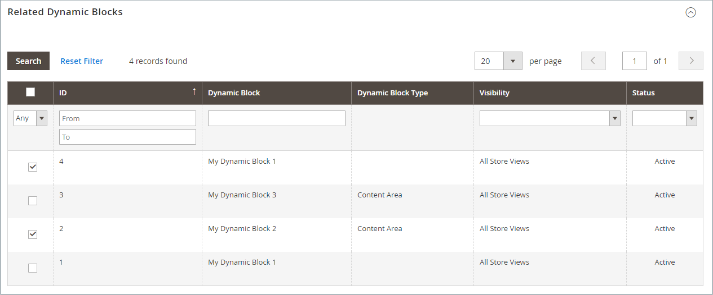
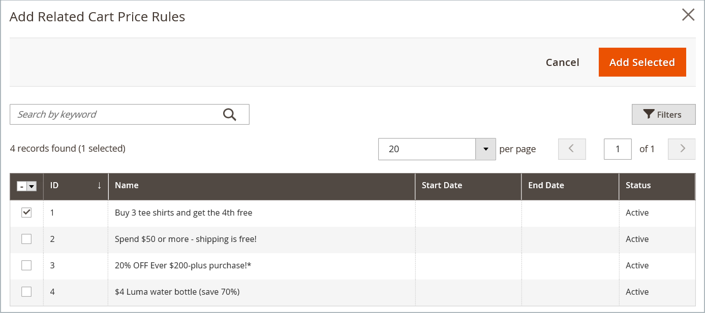

# Bloques dinámicos en reglas de precios

{{ee-feature}}

Cualquier [bloque dinámico](dynamic-blocks.md) que cree se puede asociar con una promoción. Para realizar la asociación, primero debe crear el bloque dinámico y la [regla de precio de catálogo](../merchandising-promotions/price-rules-catalog.md) o [regla de precio de carro de compras](../merchandising-promotions/price-rules-cart.md). La asociación se puede realizar mientras se trabaja en una regla de precios o cuando se trabaja en un bloque dinámico.

>[!IMPORTANT]
>
>Después de crear esta asociación, el bloque dinámico se muestra **solamente** cuando se activa la regla. Si la promoción está dirigida al segmento A, el bloque se muestra al segmento A. Si la promoción no está activa, el bloque no se muestra.

## Asociación de un bloque dinámico a una regla de precio

1. En la barra lateral _Admin_, vaya a **[!UICONTROL Marketing]** > _[!UICONTROL Promotions]_y elija una de las siguientes opciones:

   - **[!UICONTROL Catalog Price Rules]**
   - **[!UICONTROL Cart Price Rules]**

1. En la cuadrícula, busque la regla que desee asociar al bloque dinámico y ábrala en modo de edición.

1. Desplazarse hacia abajo y expandir  **[!UICONTROL Related Dynamic Blocks]**.

1. En la primera columna, establezca el filtro en `Any` y haga clic en **[!UICONTROL Reset Filter]**.

   La cuadrícula ahora enumera todos los bloques dinámicos disponibles.

1. Seleccione la casilla de verificación de cada bloque dinámico que desee asociar a la regla.

   {width="600" zoomable="yes"}

1. Una vez finalizado, haga clic en **[!UICONTROL Save]**.

## Asociación de una regla de precio a un bloque dinámico

1. En la barra lateral _Admin_, vaya a **[!UICONTROL Content]** > _[!UICONTROL Elements]_>**[!UICONTROL Dynamic Blocks]**.

1. Busque el bloque dinámico en la cuadrícula y ábralo en modo de edición.

1. Desplazarse hacia abajo y expandir **[!UICONTROL Related Promotions]**.

   Cualquier regla de precios asociada actualmente aparece en la cuadrícula.

1. Agregar una regla asociada nueva o quitar una asociación actual.

   - Para asociar una promoción del carro de compras, haga clic en **[!UICONTROL Add Cart Price Rules]**.

   - Para asociar una promoción relacionada con un producto, haga clic en **[!UICONTROL Add Catalog Price Rules]**.

1. En la cuadrícula, seleccione la casilla de verificación de cada regla que desee asociar al bloque dinámico.

1. Haga clic en **[!UICONTROL Add Selected]**.

   {width="600" zoomable="yes"}

1. Una vez finalizado, haga clic en **[!UICONTROL Save]**.
