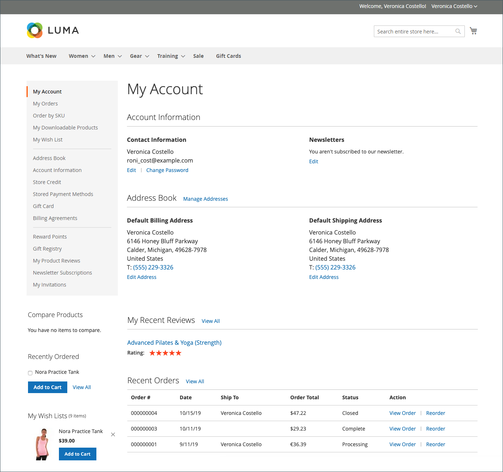

# [!UICONTROL My Account] página

La página **[!UICONTROL My Account]** del panel del cliente ofrece a los clientes una descripción general de su información y actividad relacionada con su tienda.

Esta página consta de las siguientes secciones:

* [**[!UICONTROL Account Information]**](../customers/account-dashboard-account-information.md)
* [**[!UICONTROL Address Book]**](../customers/account-dashboard-address-book.md)
* [**[!UICONTROL My Recent Reviews]**](../merchandising-promotions/product-reviews.md#product-reviews-on-the-storefront)
* [**[!UICONTROL Recent Orders]**](../stores-purchase/orders-storefront.md#view-recently-ordered-products)

{width="700" zoomable="yes"}
