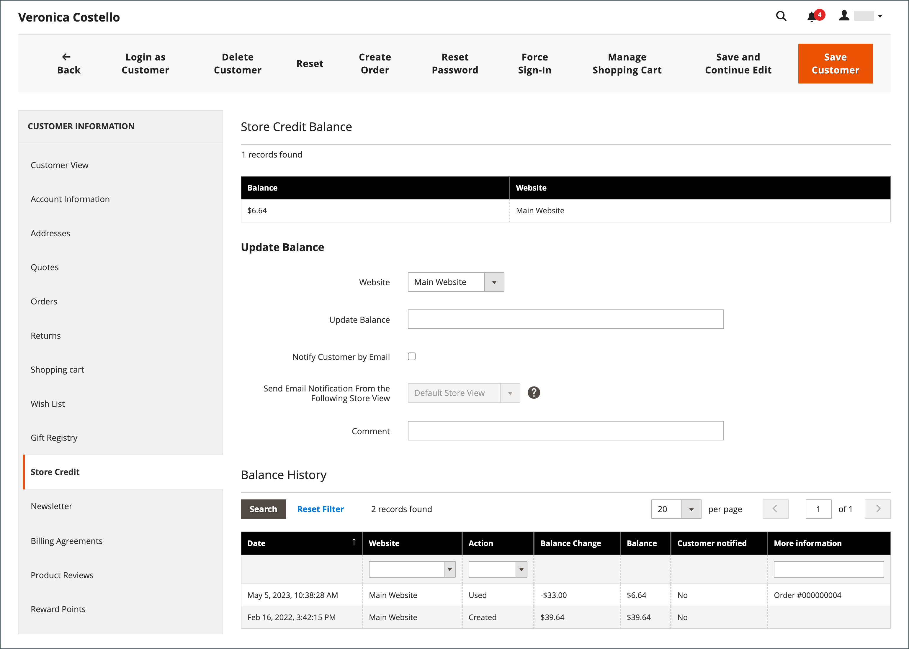
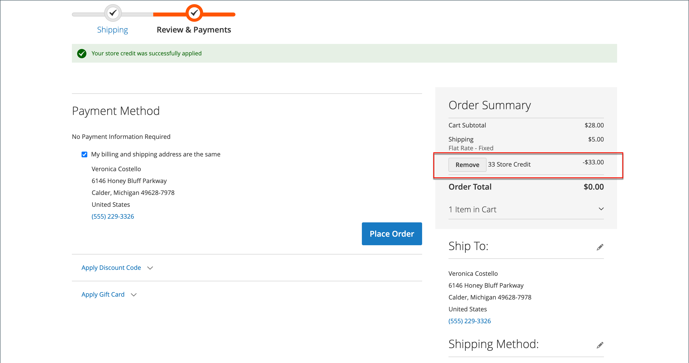

# Aplicar crédito de tienda

{{ee-feature}}

Los administradores de tienda pueden ver el saldo y el historial de crédito desde la cuenta del cliente y también aplicar el crédito de tienda a una compra.

{width="600" zoomable="yes"}

## Almacenar recursos de rol de crédito

[!BADGE Solo SaaS]{type=Positive url="https://experienceleague.adobe.com/en/docs/commerce/user-guides/product-solutions" tooltip="Solo se aplica a proyectos de Adobe Commerce as a Cloud Service (infraestructura de SaaS administrada por Adobe)."}

Los siguientes recursos determinan qué usuarios administradores pueden cambiar el saldo de crédito de tienda de un cliente y qué usuarios pueden aplicar crédito de tienda a un pedido. Para obtener información acerca de cómo asignar recursos a un rol de usuario, vea [Recursos de roles](../systems/permissions-user-roles.md#role-resources).

- **[!UICONTROL Customers]** > **[!UICONTROL All Customers]** > **[!UICONTROL Manage Store Credit Balances]** permite a los usuarios ver y actualizar los saldos acreedores del almacén. Sin ella, la ficha **[!UICONTROL Store Credit]** y **[!UICONTROL Store Credit Balance]** de la ficha **[!UICONTROL Customer View]** no serán visibles. El usuario puede seguir realizando otras ediciones en las cuentas de cliente.

- **[!UICONTROL Sales]** > **[!UICONTROL Operations]** > **[!UICONTROL Orders]** > **[!UICONTROL Actions]** > **[!UICONTROL Create]** > **[!UICONTROL Can Spend Store Credit]** permite a los usuarios aplicar crédito de tienda al [crear un pedido](../stores-purchase/customer-account-create-order.md). Sin ella, la casilla de verificación **[!UICONTROL Use Store Credit]** no estará visible.

Los usuarios administradores y las integraciones que utilizan la API de REST necesitan el recurso **[!UICONTROL Can Spend Store Credit]** para aplicar crédito de tienda a un carro de compras o para realizar un pedido de un carro de compras que ya tiene crédito de tienda aplicado. Para obtener más información, consulte [Crédito de tienda](https://developer.adobe.com/commerce/webapi/rest/saas-integrations/store-credit/).

## Ver el saldo de crédito

1. En la barra lateral _Admin_, vaya a **[!UICONTROL Customers]** > **[!UICONTROL All Customers]**.

1. Busque al cliente en la cuadrícula.

1. En la columna _Acción_, haga clic en **[!UICONTROL Edit]**.

1. Desplácese _[!UICONTROL Customer View]_&#x200B;página y vea **[!UICONTROL Store Credit Balance]**&#x200B;en la parte inferior.

{width="600" zoomable="yes"}

## Actualizar saldo de crédito del almacén

1. En la barra lateral _Admin_, vaya a **[!UICONTROL Customers]** > **[!UICONTROL All Customers]**.

1. Busque al cliente en la cuadrícula.

1. En la columna _Acción_, haga clic en **[!UICONTROL Edit]**.

1. En el panel izquierdo, elija **[!UICONTROL Store Credit]**.

1. Elija el sitio web (tienda) que desea asociar con el saldo.

1. Para **[!UICONTROL Update Balance]**, escriba el nuevo valor.

1. Para notificar al cliente la actualización del saldo, active la casilla de verificación **[!UICONTROL Notify Customer by Email]** y elija la vista de tienda de **[!UICONTROL Send Email Notification From the Following Store View]**.

1. Escriba **[!UICONTROL Comment]** acerca del cambio.

1. Cuando se hayan completado las actualizaciones, haga clic en **[!UICONTROL Save and Continue Edit]** o **[!UICONTROL Save Customer]**.

El saldo actualizado se debe mostrar en **[!UICONTROL Balance History]**.

## Aplicar un saldo acreedor a un pedido como administrador de tienda

Como administrador de tienda, puede hacer varias cosas en nombre de un cliente, incluido el envío de pedidos. Cuando [crea un pedido](../stores-purchase/customer-account-create-order.md), puede aplicar un saldo de crédito de tienda que se debe al cliente. El saldo disponible se muestra en la sección _Información de pago y envío_. Seleccione la casilla de verificación **[!UICONTROL Use Store Credit]** para aplicar el saldo o una parte del saldo si el total del pedido es menor.

{width="500" zoomable="yes"}

[!BADGE Solo SaaS]{type=Positive url="https://experienceleague.adobe.com/en/docs/commerce/user-guides/product-solutions" tooltip="Solo se aplica a proyectos de Adobe Commerce as a Cloud Service (infraestructura de SaaS administrada por Adobe)."} La casilla de verificación **[!UICONTROL Use Store Credit]** solo aparece cuando el rol de usuario incluye el recurso **[!UICONTROL Can Spend Store Credit]**. Consulte [Almacenar recursos de la función de crédito](#store-credit-role-resources).

## Aplicar crédito de tienda durante el cierre

Si hay un saldo de crédito para el sitio, el cliente puede aplicar crédito de tienda al saldo del pedido antes de colocar el pedido en la tienda.

1. El cliente consulta la cantidad de crédito de tienda disponible.

   Durante el paso _Revisar y pagar_, la cantidad disponible aparece en _[!UICONTROL Store Credit]_.

1. Para aplicar la cantidad al pedido, haga clic en **[!UICONTROL Use Store Credit]**.

   >[!INFO]
   >
   >El total del pedido se vuelve a calcular y la cantidad de crédito del almacén que se aplica aparece en _[!UICONTROL Order Summary]_.

   {width="700" zoomable="yes"}

1. Cuando esté listo, haga clic en **[!UICONTROL Place Order]**.
