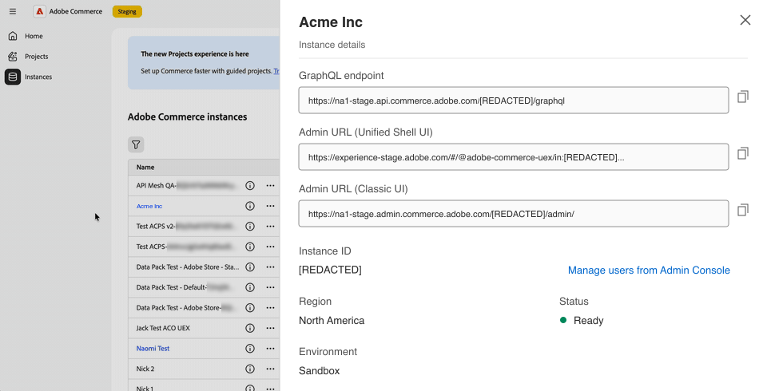
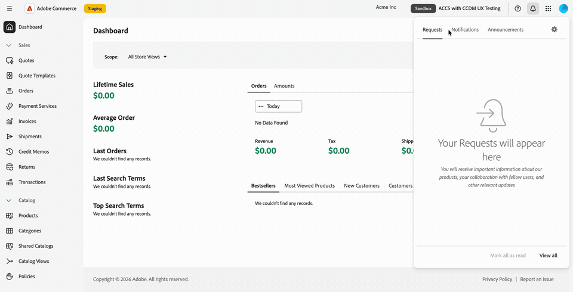
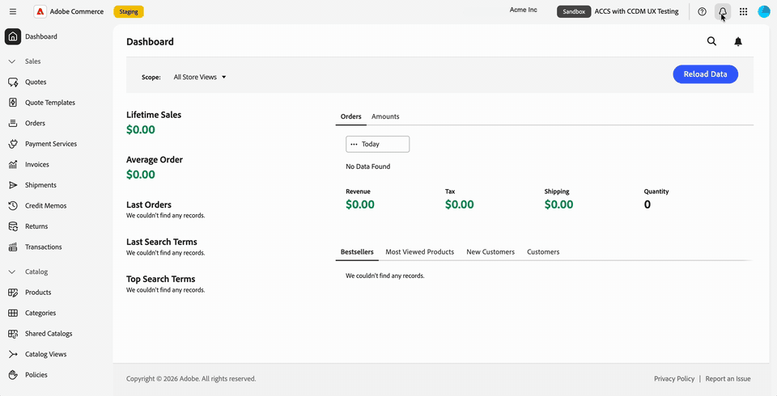
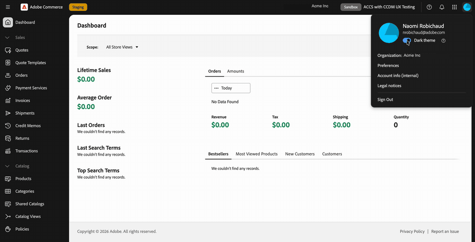

# Administrador de Commerce en Adobe Unified Experience

El Administrador de Commerce para Adobe Commerce as a Cloud Service se abre en Adobe Unified Experience al seleccionar un nombre de instancia en Commerce Cloud Manager.

La interfaz de experiencia unificada de Adobe proporciona la navegación superior compartida que se utiliza en los productos de Adobe, una navegación izquierda actualizada y un estilo de página de administración actualizado.

Puede cambiar entre organizaciones, productos e instancias de Commerce y acceder a la ayuda, las notificaciones y las preferencias de cuenta desde la barra de navegación superior. Los permisos de funciones de Commerce existentes siguen determinando a qué elementos del menú Administración puede acceder.

>[!NOTE]
>
>El administrador de Commerce en la experiencia unificada de Adobe solo está disponible para Adobe Commerce as a Cloud Service. Los clientes locales de Adobe Commerce en la infraestructura en la nube y Adobe Commerce siguen usando la [IU clásica de administración de Commerce](admin.md).

{width="800" zoomable="yes" border="light"}

## Abra el Administrador de Commerce

Después de iniciar sesión en [Adobe Experience Cloud](https://experience.adobe.com/){target="_blank"}, abra Commerce Cloud Manager. A continuación, seleccione una instancia para abrir el Administrador en la experiencia unificada.

El flujo de inicio de sesión le permite moverse entre instancias de Commerce sin iniciar sesión por separado en cada una de ellas.
Puede moverse entre los productos de Adobe y las instancias de Commerce sin más solicitudes de inicio de sesión.

Para ver el procedimiento de acceso, consulte [Acceso a una instancia](https://experienceleague.adobe.com/es/docs/commerce/cloud-service/getting-started#access-an-instance){target="_blank"} en la _Guía de Adobe Commerce as a Cloud Service_.

>[!BEGINTABS]

>[!TAB Abrir el administrador desde Commerce Cloud Manager]

{width="800" zoomable="yes" border="light"}

>[!TAB Verlo en acción]

{width="800" zoomable="yes" border="light"}

>[!ENDTABS]

### Elegir una interfaz de administración {#classic-ui}

Para la versión inicial del administrador de Commerce en Unified Experience, Adobe Commerce as a Cloud Service admite dos experiencias de administrador de Commerce, Unified Experience de Adobe y la IU clásica.

De forma predeterminada, al seleccionar una instancia de Commerce en Commerce Cloud Manager, el administrador de Commerce se abre en Adobe Unified Experience. Para volver a la IU clásica, utilice un marcador existente o busque la dirección URL de la IU clásica. Consulte [Abrir la interfaz de usuario clásica](#open-classic-ui).

Los vínculos para la experiencia unificada y la IU clásica están disponibles en el panel de detalles de la instancia en Commerce Cloud Manager.

| Vínculo | Experiencia |
| --- | --- |
| **[!UICONTROL Admin URL (Unified Shell UI)]** | Abre el administrador en la experiencia unificada. |
| **[!UICONTROL Admin URL (Classic UI)]** | Abre la interfaz de administración anterior. |

{width="800" zoomable="yes" border="light"}

_Ilustración basada en la captura de pantalla de la lista de instancias y el diseño actualizado de detalles de instancias. Las direcciones URL mostradas utilizan hosts de ensayo._

#### Formatos de URL

| Experiencia | Patrón de URL |
| --- | --- |
| Experiencia unificada | `https://<experience-cloud-host>/#/@<organization>/in:<instance-id>/commerce/cloud-service/admin` |
| IU clásica | `https://<commerce-admin-host>/<instance-id>/admin/` |

La experiencia unificada identifica la organización después de `@` y la instancia después de `in:`. La IU clásica coloca el ID de instancia directamente después del nombre de host.

Por ejemplo, estas direcciones URL de ensayo abren la misma instancia:

- **Experiencia unificada**: `https://experience-stage.adobe.com/#/@adobe-commerce-uex/in:<instance-id>/commerce/cloud-service/admin`
- **IU clásica**: `https://na1-stage.admin.commerce.adobe.com/<instance-id>/admin/`

Estos nombres de host de ensayo no son URL de producción. Utilice siempre los vínculos de instancia del Administrador de Commerce Cloud en lugar de construir direcciones URL.

#### Abrir IU clásica

Para abrir la IU clásica:

- Utilice un marcador de administración clásico o una URL existente. Estas direcciones URL solo abren la IU clásica y no redirigen a la experiencia unificada.
- Seleccione **[!UICONTROL Admin URL (Classic UI)]** en los detalles de la instancia de Commerce Cloud Manager.

No hay ningún conmutador de interfaz dentro del administrador. Utilice Commerce Cloud Manager o una URL de administración guardada para volver a la interfaz clásica si la necesita.

## Identificación de la organización y la instancia

Antes de realizar cambios, compruebe la organización y la instancia en la que está trabajando:

- El menú de cuentas muestra su organización actual.
- El conmutador de instancias en la navegación superior muestra el nombre de la instancia y un distintivo de **[!UICONTROL Production]** o **[!UICONTROL Sandbox]**.

Utilice el distintivo de entorno para distinguir una instancia de producción de una zona protegida al cambiar entre instancias.

## Cambiar organizaciones, productos e instancias

La navegación superior proporciona controles independientes para cambiar el contexto de trabajo.

### Cambio de organizaciones

Utilice el conmutador de organización en la navegación superior para desplazarse entre las organizaciones a las que tiene acceso.

1. En la barra de navegación superior, seleccione el nombre de la organización.

1. Seleccione una organización de la lista.

   La lista muestra las organizaciones a las que tiene acceso. Una marca de verificación identifica la organización en la que está trabajando.

>[!BEGINTABS]

>[!TAB Conmutador de organización]

{width="800" zoomable="yes" border="light"}

>[!TAB Verlo en acción]

{width="800" zoomable="yes" border="light"}

>[!ENDTABS]

El menú de cuenta también muestra en qué organización está trabajando. Seleccione la imagen de perfil ({width="24"}) en la barra de navegación superior y, a continuación, marque la línea **[!UICONTROL Organization]**.

{width="800" zoomable="yes" border="light"}

Las instancias que puede abrir pertenecen a la organización en la que está trabajando. Para cambiar instancias, consulte [Cambiar instancias de Commerce](#switch-commerce-instances).

### Cambiar productos

Use el conmutador de productos ({width="24"}) en la barra de navegación superior para cambiar las aplicaciones en cualquier momento. Funciona del mismo modo que en otros productos de Adobe.

- **Admin Console**: abra Adobe Admin Console desde el conmutador de productos para administrar usuarios y su acceso (**[!UICONTROL Administer]** > **[!UICONTROL Users]**). No es necesario recordar la dirección URL. Adobe Admin Console es un sitio independiente del administrador de Commerce, donde administra su tienda.
- **Adobe Exchange**: encuentre extensiones de terceros, complementos, scripts e integraciones empresariales en Adobe Creative Cloud, Adobe Experience Cloud y Adobe Document Cloud.
- **Otros productos**: Abra productos como Coworker.

>[!BEGINTABS]

>[!TAB Menú de cambio de producto]

{width="800" zoomable="yes" border="light"}

>[!TAB Verlo en acción]

{width="800" zoomable="yes" border="light"}

>[!ENDTABS]

Para la administración de usuarios y funciones de Adobe Commerce as a Cloud Service, consulte [Administración de usuarios](https://experienceleague.adobe.com/es/docs/commerce/cloud-service/user-management){target="_blank"}.

### Cambiar instancias de Commerce

La navegación superior incluye un botón del conmutador de instancias. Siempre muestra el distintivo **[!UICONTROL Production]** o **[!UICONTROL Sandbox]** y el nombre de la instancia en la que se encuentra.

1. En la barra de navegación superior, seleccione el conmutador de instancias que muestra su nombre de instancia actual y el distintivo de entorno.

1. Seleccione una instancia de la lista.

   La lista contiene las instancias de Adobe Commerce as a Cloud Service a las que puede acceder en la organización actual. No es necesario que vuelva a Commerce Cloud Manager para cambiar de instancia, de modo que pueda moverse de una instancia a otra.

1. Compruebe el nombre de la instancia y el distintivo de entorno antes de continuar con su trabajo.

La instancia forma parte de la dirección URL de la página, por lo que puede añadir un marcador o compartir un vínculo que abra una instancia específica. Si abre el administrador sin una instancia en el vínculo, se cargará la última instancia que utilizó.

## Utilice el menú de navegación izquierdo

El menú Commerce Admin aparece en la navegación izquierda de Adobe Unified Experience. Expanda o contraiga las secciones de menú para encontrar las herramientas que necesita, o escriba para saltar a un elemento de menú.

El menú es específico de la instancia en la que está trabajando. Cuando cambia de instancia, la navegación izquierda se actualiza para que coincida.

Los permisos de funciones existentes se transfieren. Solo verá los elementos de menú que su función permita.

Siga utilizando la Guía de administración para tareas como la administración de productos, pedidos, clientes y configuración. Las páginas de administración han actualizado el estilo, por lo que su aspecto puede diferir de las capturas de pantalla de la IU clásica de esta guía.

>[!BEGINTABS]

>[!TAB Navegación izquierda del administrador de Commerce]

{width="800" zoomable="yes" border="light"}

>[!TAB Verlo en acción]

{width="800" zoomable="yes" border="light"}

>[!ENDTABS]

## Obtener ayuda y proporcionar comentarios

Para acceder a los recursos sin salir del administrador de Commerce, abre el panel de ayuda con el icono de ayuda ({width="24"}) en la barra de navegación superior.

- **Ayuda**: busque documentación en Adobe Experience League directamente desde el panel.
- **Asistencia**: Acceda a foros de la comunidad y otros recursos de aprendizaje y busque sus tickets de asistencia en Adobe Experience League.
- **Comentarios**: envía comentarios a Adobe desde el mismo panel.

La ayuda, la asistencia y los comentarios están disponibles en contexto. Permanece en tu Commerce Admin y no pierdas tu lugar.

>[!BEGINTABS]

>[!TAB Panel de ayuda]

{width="800" zoomable="yes" border="light"}

>[!TAB Verlo en acción]

{width="800" zoomable="yes" border="light"}

>[!ENDTABS]

## Ver notificaciones {#view-notifications}

Para ver notificaciones, solicitudes y anuncios de productos en contexto, abra el panel de notificaciones con el icono de campana ({width="24"}) en la barra de navegación superior.

El panel reúne sus **[!UICONTROL Requests]**, **[!UICONTROL Notifications]** y **[!UICONTROL Announcements]** en un solo lugar. No es necesario que abandone el administrador de Commerce para ver ninguno de ellos.

Utilice el icono de campana en la navegación superior de la experiencia unificada para este panel, en lugar del control de notificaciones dentro del encabezado de la página de Commerce. Para obtener instrucciones acerca de los mensajes de la Bandeja de entrada de Commerce Admin, consulte [Bandeja de entrada de mensajes](admin-message-inbox.md).

>[!BEGINTABS]

>[!TAB Panel de notificaciones]

{width="800" zoomable="yes" border="light"}

>[!TAB Verlo en acción]

{width="800" zoomable="yes" border="light"}

>[!ENDTABS]

## Administrar preferencias de cuenta

Seleccione la imagen de perfil ({width="24"}) en la barra de navegación superior para abrir el menú de cuenta. Desde este menú, puede:

- Vea la organización en la que está trabajando.
- Activar el modo oscuro con la opción **[!UICONTROL Dark theme]**.
- Abra las preferencias de usuario.

>[!BEGINTABS]

>[!TAB Menú de cuenta con modo oscuro]

{width="800" zoomable="yes" border="light"}

>[!TAB Verlo en acción]

{width="800" zoomable="yes" border="light"}

>[!ENDTABS]

## Estilo de página actualizado

Las páginas del administrador de Commerce tienen un aspecto actualizado que coincide con la experiencia unificada de Adobe. Se ha planificado un mayor rediseño para las versiones posteriores.

>[!MORELIKETHIS]
>
>[Interfaz de Adobe CX Enterprise y guía de administración](https://experienceleague.adobe.com/es/docs/core-services/interface/experience-cloud)
