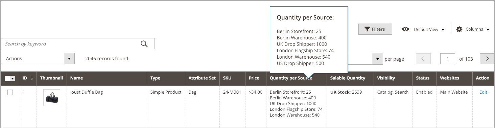

# Administrar cantidades de inventario

Siga estas directrices para asignar orígenes y cantidades para productos nuevos o existentes.

Al crear productos, asigne orígenes y cantidades durante la creación del producto. Consulte [Crear un producto](../catalog/product-create.md) para obtener instrucciones completas. Estas páginas incluyen información de un solo origen y de varios orígenes para orígenes y cantidades por origen.

Al obtener acceso por primera vez a un(a) [!DNL Commerce] actualizado(a) con [!DNL Inventory Management], todos los productos y cantidades se asignan a la Source predeterminada. Al importar nuevos productos a través del archivo .csv, también se asignan al Source predeterminado.

Los comerciantes de uno o varios orígenes pueden actualizar los orígenes, las cantidades de inventario y los umbrales por producto o por lote.

- Los comerciantes de un solo origen pueden actualizar las cantidades de productos para la Source predeterminada. Esta cantidad es el número total de productos disponibles para la venta.

- Los comerciantes de varios orígenes pueden asignar varios orígenes y cantidades por producto para cada ubicación (almacenes, tiendas, distribuidores directos entre otros). Se recomienda agregar orígenes antes de establecer importes de inventario de productos.

Al añadir orígenes y cantidades a los productos, puede ver las cantidades a través de la cuadrícula de productos. Si tiene un número elevado de orígenes, pase el ratón sobre _[!UICONTROL Quantity per Source]_para ver la lista completa y desplazable de orígenes con cantidades actuales.

{width="600" zoomable="yes"}

Tiene las siguientes opciones para asignar un inventario a los productos:

- [Asignación de fuentes por producto](sources-assign-per-product.md): asigne fuentes manualmente por producto en su catálogo.

- [Asignación de cantidades por producto](quantities-assign-per-product.md) - Agregue cantidades de inventario disponible a sus productos por origen. Esta información es específica para comerciantes de varias fuentes.

- [Asignación y desasignación masiva de orígenes](bulk-assignment.md) - Asignar orígenes a productos seleccionados como una acción masiva. Utilice la opción [Transferir inventario a Source](inventory-transfer.md) si desea transferir el inventario y eliminar el origen.

- [Transferencia de inventario a Source](inventory-transfer.md) - Transferencia masiva de todo el inventario de un origen a un origen de destino.

- [Importación y exportación de cantidades](inventory-import-export.md) - Utilice las características de importación y exportación para actualizar varias SKU de producto con orígenes y cantidades de inventario.
