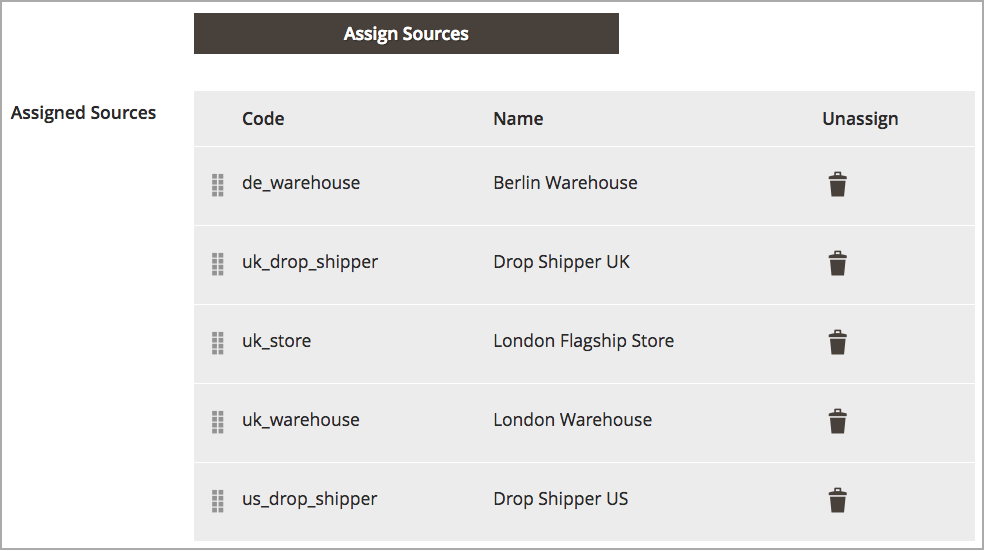

# Priorización de orígenes para una existencia

Después de agregar [orígenes](sources-manage.md) a [existencias](stocks-manage.md), organice esos orígenes de arriba a abajo con prioridad para cumplir los pedidos. El Algoritmo de Selección de Source (SSA) proporciona un algoritmo Prioridad utilizando este pedido al determinar las deducciones de envío e inventario.

La prioridad de las fuentes sobre las existencias no influye en las fuentes asignadas al editar los inventarios de productos.

En este ejemplo, las acciones del Reino Unido tienen fuentes asignadas de forma desordenada para una tienda y dos almacenes en Londres y un almacén en Berlín.

{width="350" zoomable="yes"}

El comerciante prefiere tener los envíos priorizados desde el almacén más grande de Berlín, luego el almacén de Londres, la ubicación de desbordamiento de Londres, y finalmente la tienda en Londres. Para cambiar el orden, las entradas se arrastran y se sueltan en el orden deseado.

1. En la barra lateral _Admin_, vaya a **[!UICONTROL Stores]** > _[!UICONTROL Inventory]_>**[!UICONTROL Stocks]**.

1. Abra las existencias en el modo _Editar_.

1. Expanda la ficha _[!UICONTROL Sources]_, si es necesario.

1. Use  para arrastrar y soltar los orígenes en una prioridad de arriba (primero) a abajo (último).

   Este pedido es importante cuando se envían pedidos. SSA recomienda envíos basados en el orden de las fuentes

1. Haga clic en **[!UICONTROL Save & Continue]** para guardar los cambios.

{width="350" zoomable="yes"}
