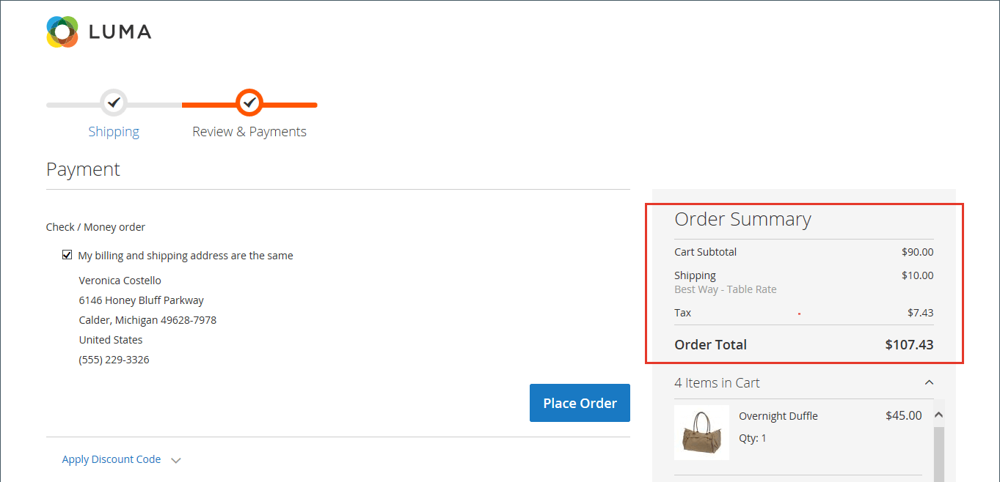
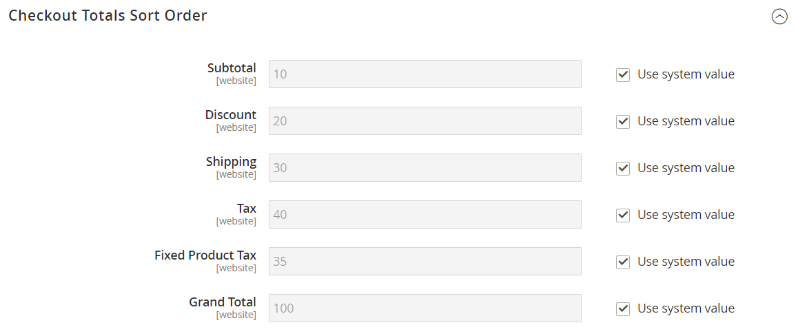

# Orden de los totales de cierre de compra

Durante la revisión del pedido, el total aparece en la parte inferior del pedido, con ajustes por descuentos, gastos de envío, crédito de tienda e impuestos. El orden de cada elemento determina la secuencia de los cálculos y se establece en la configuración mediante un número asignado a cada elemento. Por ejemplo, el subtotal es el primer elemento de la sección y se le asigna un valor de 10. El Total general aparece en último lugar y se asigna un valor de 100. A todos los demás elementos de la sección de totales se les asigna un valor entre esos valores.

{width="700" zoomable="yes"}

**_Para configurar el criterio de ordenación de totales de desprotección:_**

1. En la barra lateral _Admin_, vaya a **[!UICONTROL Stores]** > **[!UICONTROL Configuration]**.

1. En el panel izquierdo, expanda la sección **[!UICONTROL Sales]** y elija **[!UICONTROL Sales]** debajo.

1. Expanda  en la sección **[!UICONTROL Checkout Totals Sort Order]**.

   {width="600" zoomable="yes"}

   Para obtener una descripción detallada de cada una de estas opciones de configuración, consulte [Orden de clasificación de totales de desprotección](../configuration-reference/sales/sales.md#checkout-totals-sort-order) en la _Guía de referencia de configuración_.

1. Si la configuración es para una vista de tienda específica, [elija la vista de tienda](../configuration-reference/scope-change.md#set-the-scope) donde se aplica la configuración.

   Cuando se le solicite, haga clic en **[!UICONTROL OK]** para continuar.

1. Para determinar el orden en la sección _Totales_, cambie el número asignado a cada elemento.

   Cuanto más bajo sea el valor, antes se colocará en la lista. En la configuración predeterminada, el subtotal (`10`) es el primero y el total general (`100`) es el último.

   Si es necesario, desactive la casilla de verificación **[!UICONTROL Use system value]** para completar estos cambios.

1. Haga clic en **[!UICONTROL Save Config]**.
