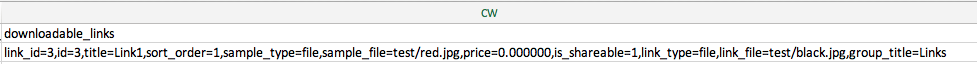

# Importar productos descargables

El flujo para importar productos descargables es el mismo que para [Productos agrupados](data-transfer-bundle-products.md) o [Productos configurables](data-transfer-configurable-products.md). La diferencia es que un producto descargable tiene [vínculos descargables](../catalog/product-create-downloadable.md) y [muestras descargables](../catalog/product-create-downloadable.md) con sus imágenes.

El directorio raíz predeterminado para vínculos descargables y ejemplos es `<Magento-root-folder>/pub/media/import`. Si el módulo de almacenamiento remoto está habilitado, el directorio raíz predeterminado para los vínculos descargables y las muestras es el directorio `<remote-storage-root-folder>/media/import`.

El archivo CSV tiene columnas independientes para `downloadable_links` y `downloadable_samples`.

- **Imágenes de vínculos descargables**: en el siguiente ejemplo, las imágenes de vínculos descargables (`red.jpg` y `black.jpg`) se encuentran en la carpeta `<Magento-root-folder>/pub/media/import/test`. Si el almacenamiento remoto está habilitado, estas imágenes se encuentran en la carpeta `<remote-storage-root-folder>/media/import/test`.

  {width="600" zoomable="yes"}

- **Imágenes de muestra descargables**: en el siguiente ejemplo, la imagen de muestra descargable (`white.jpg`) se encuentra en la carpeta `<Magento-root-folder>/pub/media/import/test`. Si el almacenamiento remoto está habilitado, esta imagen se encuentra en la carpeta `<remote-storage-root-folder>/media/import/test`.

  {width="400" zoomable="yes"}

Para obtener más información acerca de cómo habilitar y administrar el módulo de almacenamiento remoto, consulte [Configurar almacenamiento remoto](https://experienceleague.adobe.com/es/docs/commerce-operations/configuration-guide/storage/remote-storage/remote-storage) en la _Guía de configuración_.
